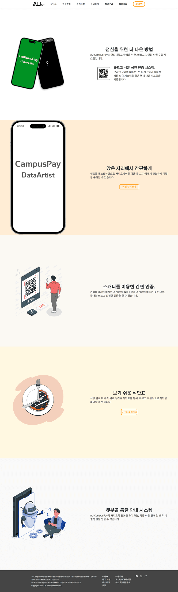
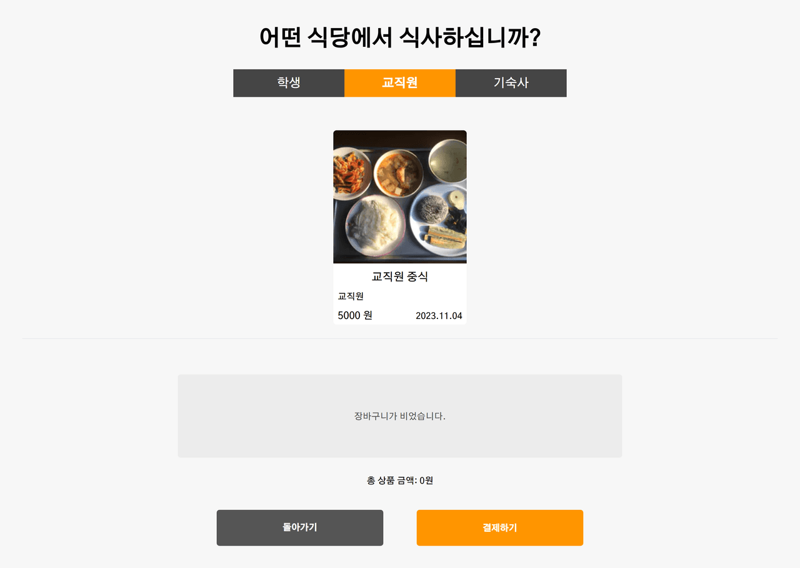
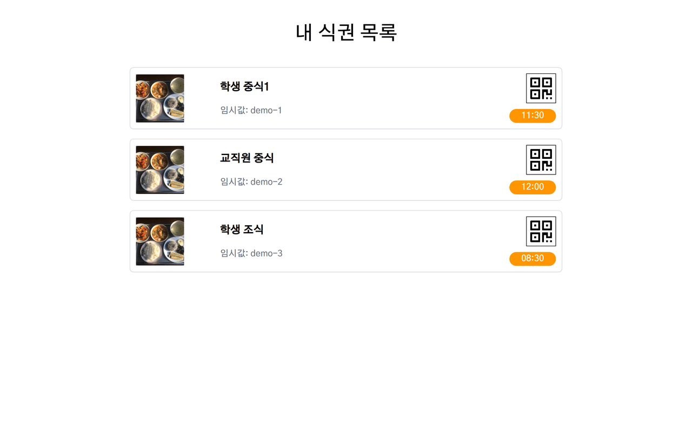
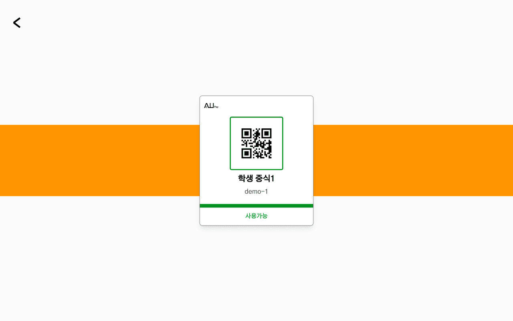
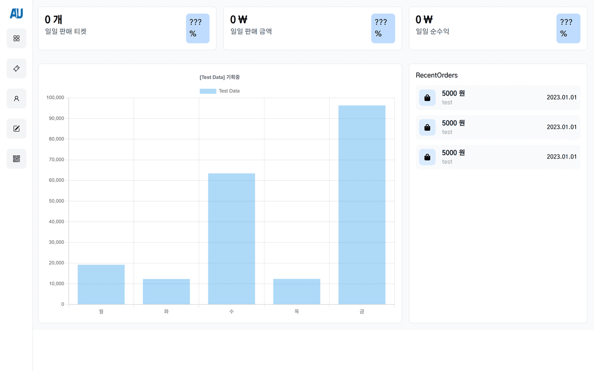
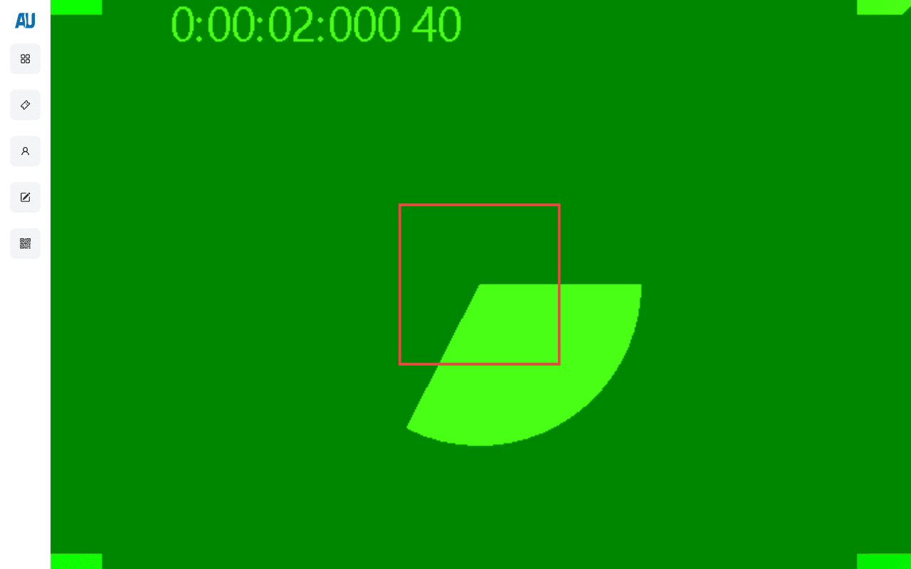
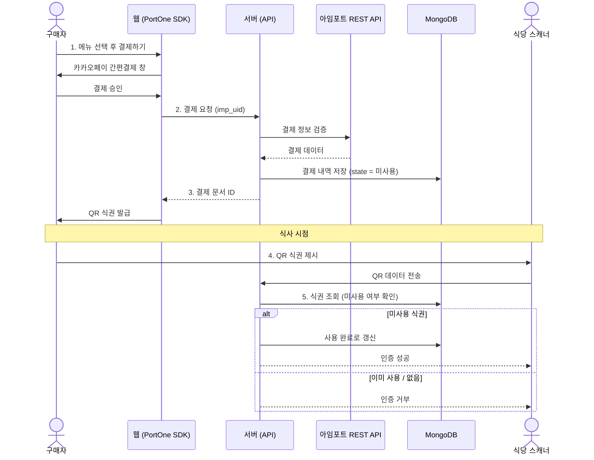

<div align="center">


# AU CampusPay

**안산대학교 학식, 줄 서지 않고 휴대폰으로 끝내는 디지털 식권 시스템**

매표소 대기와 식권 제출 줄로 30분 넘게 걸리던 학식 이용을, 온라인 결제와 QR 인증으로 단축한 졸업작품 프로젝트입니다.

<br />

[](https://nextjs.org/)
[](https://react.dev/)
[](https://www.typescriptlang.org/)
[](https://www.mongodb.com/)
[](https://tailwindcss.com/)
[](https://next-auth.js.org/)

[기능](#주요-기능) · [스크린샷](#스크린샷) · [동작 흐름](#결제-및-인증-흐름) · [시작하기](#시작하기) · [프로젝트 구조](#프로젝트-구조)

</div>

---

## 프로젝트 배경

기존 학식 이용은 매표소에서 식권을 사고, 줄을 서서 식권을 제출하고, 식사를 받기까지 대기 시간이 30분 이상 소요되는 문제가 있었습니다. AU CampusPay는 **구매(온라인 결제)** 와 **인증(QR 스캔)** 을 분리해 매표 줄과 인증 줄을 동시에 없애는 것을 목표로 합니다.

- 매표소 대신 본인의 휴대폰이나 노트북에서 바로 식권을 구매
- 종이 식권 대신 QR 코드로 발급되는 디지털 식권
- 식당에 비치된 스캐너에 QR을 비추는 것만으로 끝나는 식권 인증

<br />

## 주요 기능

### 이용자

| 기능 | 설명 |
| --- | --- |
| 회원가입 / 로그인 | 아이디·비밀번호 기반 가입과 GitHub 소셜 로그인 지원. 비밀번호는 bcrypt로 해싱해 저장 |
| 식권 구매 | 학생 / 교직원 / 기숙사 구분에 따라 메뉴와 가격이 달라지며, 카카오페이 간편결제로 즉시 결제 |
| 디지털 식권 발급 | 결제 완료 시 식권마다 고유 QR 코드를 생성 |
| 내 식권 목록 | 로그인 사용자 기준으로 아직 사용하지 않은 식권만 모아서 표시 |
| 식권 확인 | QR 코드와 사용 가능 / 사용 불가 상태를 함께 표시 |
| 부가 기능 | 비밀번호 찾기·변경, 공지사항 조회, 이용 가이드 |

### 관리자

| 기능 | 설명 |
| --- | --- |
| 대시보드 | 당일 판매 식권 수, 총 매출, 순수익을 카드와 차트로 시각화 |
| QR 스캐너 | 카메라로 식권 QR을 읽어 유효성을 검증하고, 사용된 식권은 즉시 사용 완료로 처리 |
| 주문 / 고객 관리 | 주문 내역과 고객 정보 조회 |
| 공지 관리 | 공지사항 작성·수정·삭제 |

<br />

## 스크린샷
### 이용자 화면

| 메인 | 식권 구매 | 내 식권 목록 | 식권 QR 확인 |
| :---: | :---: | :---: | :---: |
|  |  |  |  |

### 관리자 화면

| 대시보드 | QR 스캐너 |
| :---: | :---: |
|  |  |

<br />

## 결제 및 인증 흐름



<br />

## 기술 스택

| 구분 | 사용 기술 |
| --- | --- |
| 프레임워크 | Next.js 13 (App Router), React 18, TypeScript |
| 스타일 | Tailwind CSS, Sass |
| 데이터베이스 | MongoDB |
| 인증 | NextAuth.js (Credentials, GitHub), bcrypt |
| 결제 | PortOne(아임포트) Browser SDK v2, 아임포트 REST API (카카오페이) |
| QR | qrcode (생성), @zxing/library (스캔) |
| 데이터 시각화 | Chart.js, react-chartjs-2 |
| 데이터 패칭 | SWR |

<br />

## 시작하기

### 요구 사항

- Node.js 18 이상
- MongoDB 인스턴스 (로컬 또는 Atlas)

### 설치 및 실행

```bash
# 1. 의존성 설치
npm install

# 2. 환경 변수 설정 (아래 참고)
cp .env.example .env.local

# 3. 개발 서버 실행
npm run dev
```

실행 후 [http://localhost:3000](http://localhost:3000) 에서 확인할 수 있습니다.

### 환경 변수

프로젝트 루트에 `.env.local` 파일을 만들고 아래 값을 채워 주세요.

```bash
# MongoDB
MONGODB_URL=               # MongoDB 연결 문자열
MONGODB_NAME=              # 데이터베이스 이름
MONGODB_USER=              # 사용자 컬렉션 이름
MONGODB_PAYMENT=           # 결제(식권) 컬렉션 이름

# 사이트
SITE_URL=http://localhost:3000

# NextAuth
NEXTAUTH_SECRET=           # 세션 암호화 시크릿
GITHUB_CLIENT_ID=          # GitHub OAuth 사용 시
GITHUB_CLIENT_SECRET=

# 아임포트 (서버 결제 검증)
IAMPORT_API_KEY=
IAMPORT_API_SECRET=

# PortOne (클라이언트 결제 요청)
NEXT_PUBLIC_PORTONE_STORE_ID=
NEXT_PUBLIC_PORTONE_CHANNEL_KEY=
```

### 스크립트

| 명령 | 설명 |
| --- | --- |
| `npm run dev` | 개발 서버 실행 |
| `npm run build` | 프로덕션 빌드 |
| `npm run start` | 프로덕션 서버 실행 |
| `npm run lint` | 린트 검사 |

<br />

## 프로젝트 구조

```
src/
├── app/
│   ├── (auth)/             로그인, 회원가입
│   ├── (inquiry)/          비밀번호 찾기·변경
│   ├── (write)/            공지 작성·수정
│   ├── admin/              관리자 대시보드, 스캐너, 주문, 고객
│   ├── api/                API 라우트
│   │   ├── auth/           NextAuth 설정
│   │   ├── payment/        결제 검증 및 저장
│   │   ├── scanner/        QR 검증 및 사용 처리
│   │   ├── register/       회원가입
│   │   ├── admin/          통계·공지 CRUD
│   │   └── db/             MongoDB 연결
│   ├── payment/            식권 구매 화면
│   ├── ticket/             내 식권 목록
│   ├── confirmation/       식권 QR 확인
│   └── ...
├── components/             UI 컴포넌트 (네비, 폼, 차트, 아이콘 등)
├── model/                  타입 정의 (User, Menu)
└── service/                날짜 등 유틸
```

<br />

## 참고 사항

- 현재 결제·식권·관리자 화면의 일부 인증 가드가 임시로 비활성화되어 있습니다. MongoDB가 연결되지 않은 환경에서도 화면을 확인할 수 있도록 한 조치로, 해당 페이지의 주석을 해제하면 로그인 또는 관리자 권한이 다시 필수로 동작합니다.
- 데이터베이스에 연결되지 않으면 식권 목록과 통계는 샘플 데이터 또는 기본값으로 대체되어 화면이 깨지지 않습니다.

<br />

<div align="center">

안산대학교 졸업작품 프로젝트

</div>
